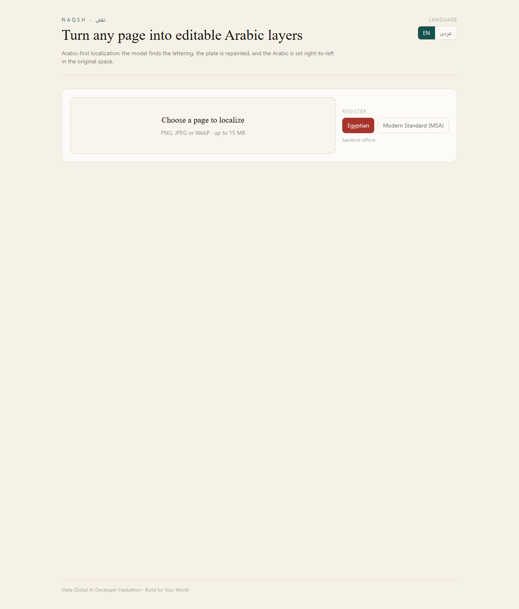
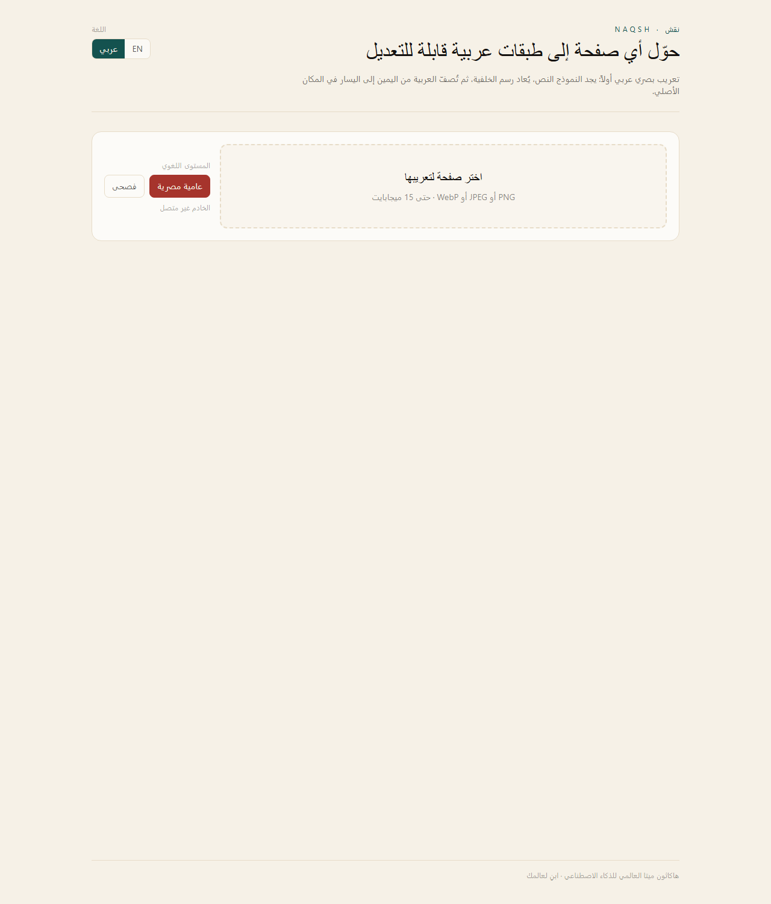

# UI language toggle — evidence

2026-10-27. English default, Arabic switchable at runtime.

## What the screenshots show

- **EN** (default, `<html lang="en" dir="ltr">`): header, upload, register labels,
  status line compact in the top-right.
- **AR** (`?lang=ar`, `<html lang="ar" dir="rtl">`): the chrome mirrors — the
  language switch moves to the left, the upload zone and register block swap sides,
  and every visible chrome string is Arabic.
- The brand lockup keeps `NAQSH · نقش` in both languages on purpose.

`?lang=ar` exists so a link (and this screenshot script) can open the Arabic chrome
without clicking; the toggle still persists the choice in `localStorage`.

## What the screenshots do not show (manual check list)

The result screen needs a running backend, so it was not captured. Check by hand:

1. Upload `assets/generated/fixtures/01-comic-flat.png` with the backend running.
2. Before/after images: they must **not** mirror in Arabic mode (both figures are
   `dir="ltr"`), and the caption text under them switches language.
3. Region list: each translation stays `dir="rtl" lang="ar"` with the Arabic font in
   both UI languages.
4. Receipt: stage names translate (`read` → القراءة, …), numbers keep `dir="ltr"`.
5. Errors: stop the backend and upload — the message is translated in both modes.
6. Reload after switching to Arabic: the choice persists.

## Known draft quality

Arabic UI copy is a first draft, marked `TODO(native-review)` in
`frontend/src/i18n.ts`; the owner reviews before the demo.
