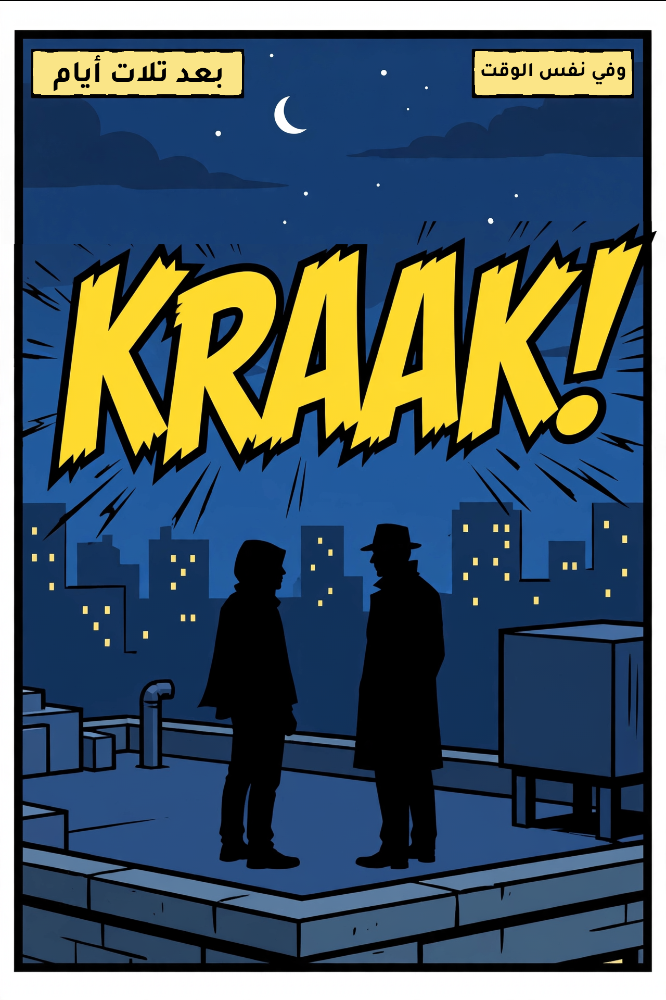
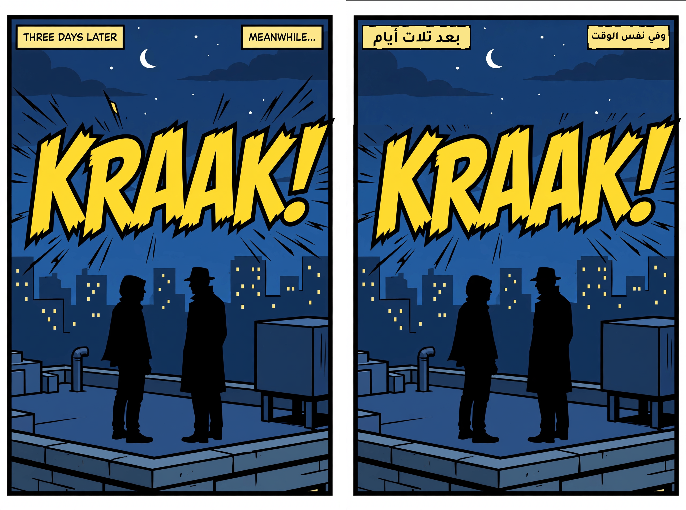
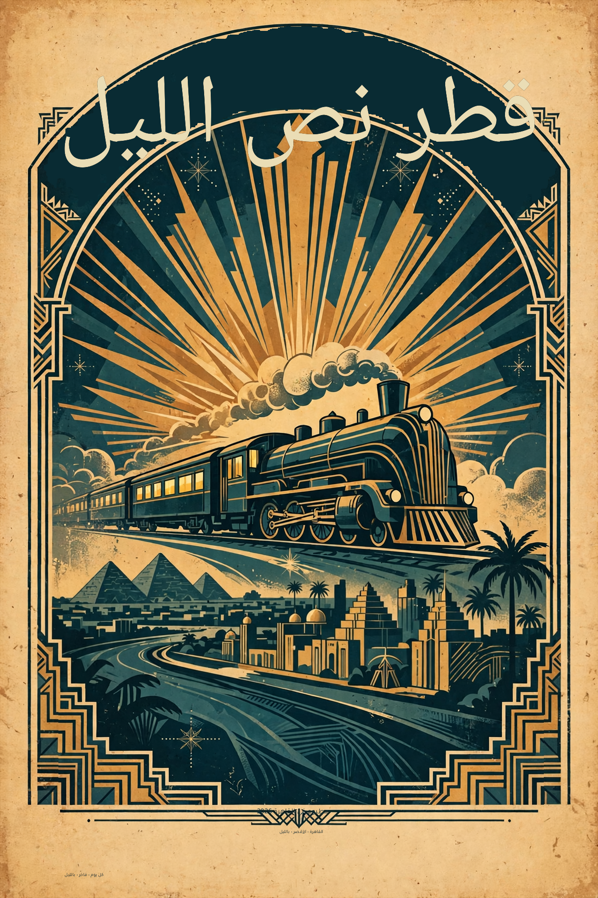

# Phase 5 — region strategy and recall

2026-10-27, Cairo. Ground truth = the strings used to generate each fixture (or the
visible strings of the public-domain poster). One read per page, matched with a
normalised fuzzy match (threshold 0.72); prices found as their own regions count as
correct, not as hallucinations.

## Recall / precision, per page

| Page | Expected | Found | Recall | Precision | Notes |
| --- | --- | --- | --- | --- | --- |
| 01 comic (flat) | 3 | 3 | 1.00 | 1.00 | — |
| 02 poster (watercolour) | 3 | 3 | 1.00 | 1.00 | — |
| 03 menu (paper) | 10 | 16 | 1.00 | 1.00 | 6 of the extra regions are standalone prices (`price` → keep numerals) |
| 04 chalkboard | 3 | 5 | 1.00 | 0.60 | this run split each item into item + price and duplicated two items (merged=2, split=2); a second inspection run returned the 3 clean regions, so this is run variance, not a systematic miss |
| 05 label (kraft) | 3 | 3 | 1.00 | 1.00 | — |
| 06 real PD poster | 7 | 8 | 1.00 | 0.88 | top line split into `LONDON, BRIGHTON & SOUTH COAST` + `RAILWAY.` (split=1) |
| 07 comic (SFX) | 3 | 3 | 1.00 | 1.00 | SFX typed `sfx` |
| 08 curved poster | 4 | 4 | 1.00 | 1.00 | curved headline read correctly |

**Recall is 1.00 on all eight pages**, so no recall fix was needed and there is no
before/after cost to report for a fix. Read cost per page: **$0.0066–$0.0127**
(menu and PD poster at the top of the range because they are text-dense).

Failure classes observed: **splits** on two pages (one line reported as two
regions; chalkboard item+price), **no hallucinations**, no missing strings.

## Region policy (visible flag, logged per region)

Spark returns a `type`; the receipt records `type` and `action` for every region:

| Type | Default action |
| --- | --- |
| dialogue, caption, signage, menu_item, title | translate |
| price / standalone number | keep_numerals (Latin digits redrawn, no Arabic) |
| logo, decorative | skip (original pixels untouched) |
| sfx | optional, off by default (original pixels untouched) |

Skipped and optional regions are excluded from segmentation and repainting, so the
original artwork stays. On the SFX page the captions are translated and `KRAAK!`
is left as printed.

## Curved and rotated text: not supported

The curved headline in `08-curved-poster` is read correctly and translated, but it
is set as a straight line inside its bounding box: the arch is not followed and the
line can overflow the decorative frame. Rotation/curvature would need per-glyph
placement along a path; it is **scoped out** for the hackathon and stated here
rather than faked.

## Cost

Recall eval (8 reads) $0.0667; two inspection reads $0.0158; two pipeline runs
$0.0589; two generated fixtures $0.0200. Total for this phase ≈ **$0.161**.
