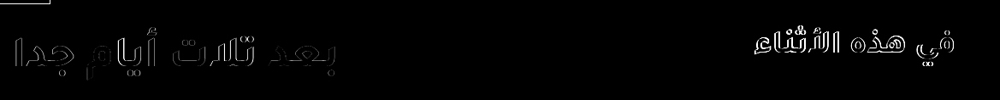

# Submission notes — living document

Update this **as work happens**. It feeds the submission form, the demo video
script, and the X post. Every claim here should be something we can show.

Submission form: Cerebral Valley platform, one per project. Deadline **4 Nov
2026, 9:00 PM ET** (≈ 4:00 AM 5 Nov Cairo). Internal submit date: **3 Nov**.

## Form fields — current state

| Field | Status | Content / where it lives |
| --- | --- | --- |
| Team name | ready | **Naqsh** |
| Team member | ready | Mostafa Eid (Lleoparden) |
| Track | ready | Indie Developer |
| Problem statement | ready | Build for Your World |
| Most Viral Track (X post link) | pending | Build-in-public clip; media folder below |
| Project description | draft | README pitch; tighten to ~150 words for the form |
| Public GitHub repo | in progress | `https://github.com/lleoparden/naqsh` (public) |
| 3-minute demo video | pending | Script outline below; backup target 30 Oct |
| Use of Meta products | draft | Model roles table below |
| Why Meta's models matter | draft | Below — what each model does that another tool couldn't |
| Feedback on Meta products | collecting | Friction log below |
| Feedback on partner technologies | optional | — |

## What each Meta model does, and why it mattered

Fill this in with *observed* behavior, not the pitch.

- **SAM 3.1 — geometry.** Turns "find the lettering" into pixel-accurate masks with
  stable object ids. Why it mattered: the layer boundary is the real bubble shape,
  so Arabic can be fitted to it instead of a guessed rectangle. *(Observed: a
  two-word concept prompt found both speech bubbles at 0.96 confidence, and a box
  prompt tightened a caption region to the panel edge. A `text` concept prompt found
  nothing — the model is prompted with objects, not "text", which is why Spark's
  boxes drive it.)*
- **Muse Spark — reading and rewriting.** One call returns the source text, its
  position, a natural Arabic line, and a lettering style. Why it mattered: the
  translation must fit the space, so text and style are decided together; a
  text-only pipeline would need OCR + translator + classifier. *(Observed: 3/3
  regions read exactly, valid JSON, and `أشوفك بكرة وهجيب معايا الرسومات` for "See
  you tomorrow, I'll bring the sketches" — proper Egyptian colloquial.)*
- **Muse Image — repainting the plate.** Removes the original lettering while
  keeping the artwork. Why it mattered: without it Naqsh could only cover lettering
  with flat boxes. *(Observed: all three text regions erased in 13.6 s for $0.01,
  bubbles left empty and the character unchanged — but the whole page is re-rendered
  with a vertical offset that varies per run (-16, -30, -40 px measured), so the
  plate must be registered before compositing.)*
- **Muse Spark as the QA loop.** The same vision model that reads the page also
  checks the cleaned plate at 100% zoom and reports which regions still show
  lettering. Why it mattered: a pixel threshold could not separate clean from
  ghosted plates, but the model can look. *(Observed: it caught residual text in
  7/10 regions on the dense menu page that the threshold missed; one retry then
  cleared them.)*

## API friction log (write it when it happens)

| When (Cairo) | What | Detail | Impact |
| --- | --- | --- | --- |
| 2026-10-27 15:20 | Reachability | `GET /v1/models` and `POST /v1/chat/completions` return 401 over HTTPS from Cairo; no timeout, no geo-block at the network layer. | Good — no VPN needed. |
| 2026-10-27 15:40 | Muse Image has no mask parameter | Multipart `mask` returns `400 unsupported_parameter`; edits are instruction-only. Docs also do not promise geometry preservation. | Design change: composite edit output through SAM masks (Plan A), classical inpaint (Plan B), opaque cover (Plan C). |
| 2026-10-27 15:40 | SAM output is special-token text | Masks are compressed base85 payloads inside `<|mask;...|>` tokens, one `output_text` line per frame, streamed. A hand-built decoder fails; `meta-sam-parser` decodes it. | One dependency, and the mask raster is the size of the object's box, not the page. Budgeted an hour; it took about that. |
| 2026-10-27 15:36 | Reasoning tokens ate the answer | With `max_output_tokens: 400`, Spark returned `status: incomplete` and **398 of 400 output tokens were reasoning** — an empty answer that looked like a JSON bug. | Two wasted calls; fix is `reasoning.effort: minimal` + a realistic token budget. Worth saying in the Meta feedback. |
| 2026-10-27 15:37 | SAM concept prompt `text` finds nothing | 0 matches, 200 OK, empty lane, still billed. `speech bubble` found both bubbles. | Region strategy: Spark bboxes → SAM box prompts, concepts only for containers. |
| 2026-10-27 15:39 | Box prompt syntax is not obvious | `<|box;…|>` alone → `400 invalid prompt: … geometric prompts go after a <Nf> frame header`. | Correct form: `<0f>1<|box;…|>` with caller-chosen ids. Docs describe it; the error message is what made it stick. |
| 2026-10-27 15:38 | Muse Image edit shifts the page | Phase correlation on before/after: ≈ -16 px vertical on the first pair, later runs -30 and -40 px. | Registration is required and is per-run, not a constant. |
| 2026-10-27 16:00 | Plate edits are intermittent | 7 runs: 4 clean, 2 with a faint ghost, 1 with a smeared caption panel. | Phase 4 gate owns this. The composite is correct; the ghost is in the plate. |
| 2026-10-27 16:20 | The ghost is mostly *ours*, not the model's | Comparing three failing runs, residual lettering sat outside the repaint coverage (e.g. 6,894 px outside vs 5,444 inside): the original lettering was taller than Spark's box and the SAM mask. | Coverage now grows from the source's real ink extent; the plate itself was clean in those runs. |
| 2026-10-27 16:35 | dirty_ratio cannot be trusted | Clean ≈0.05, ghosted 0.08–0.13, with overlap; a threshold retry doubled cost without reliably fixing the page. | Detection moved to a Muse Spark vision check over 100%-zoom crops. |
| 2026-10-27 17:00 | The plate flattens painted texture | Watercolour poster: the edit replaced the painted band behind the title with a solid teal strip. No letters left, but it reads as a smear. | Detector only asks about lettering, so it passed this. Textured pages are the open limit. |
| 2026-10-27 17:55 | فلالفل was my misreading, not the model | Search of every job receipt found no `فلالفل`; the recorded MSA translation is `فلافل 20`. The misspelling came from reading a downscaled contact sheet. | No pipeline bug: `_strip_leaders` only removes dots, shaping never rewrites the string. Added tests and a standard-spelling line in the prompt as a guard. |

## Notable results and numbers

| Date | Number | How it was measured |
| --- | --- | --- |
| 2026-10-27 | API reachable from Cairo, first byte < 1 s (401 response) | `Invoke-WebRequest` timing during the reachability check |
| 2026-10-27 | Spark vision read: 6.8 s, 3,367 in / 435 out tokens, **$0.00606** | Probe receipt `spark-image-20261027T123659Z.json` |
| 2026-10-27 | Spark Arabic line: 2.0 s, 137 in / 268 out (204 reasoning), **$0.00131** | Probe receipt `spark-text-20261027T123630Z.json` |
| 2026-10-27 | SAM bubbles: 3.4 s, 2 masks, conf 0.961, **$0.0025** | Probe receipt `sam-20261027T123816Z.json` + overlay PNG |
| 2026-10-27 | Muse Image generate: 12.2 s, 1280×1920 out for a 1024×1536 request, **$0.01** | Probe receipt `image-generate-20261027T123645Z.json` |
| 2026-10-27 | Muse Image edit: 13.6 s, lettering gone, **$0.01**, ≈16 px page shift | `image-edit-…json` + local phase-correlation measurement |
| 2026-10-27 | **Phase 2 pipeline, generated page: 25–30 s, $0.0184–$0.0194 per page** | Per-stage receipts in `docs/evidence/phase-2/receipt-egyptian.json` |
| 2026-10-27 | Register comparison, same page | Egyptian `عيش طازة؟` / `كل يوم الصبح` vs MSA `خبز طازج؟` / `كل صباح` — same layout, same cost |
| 2026-10-27 | Clean-plate reliability: 4/7 runs clean, 2 ghosted, 1 smeared | Visual review of `docs/evidence/phase-2/failure-ghost-lettering.png` |
| 2026-10-27 | **Phase 4 gate: 10 runs / 5 pages, $0.2975 total, $0.0298 per run, 75 s per run** | `docs/evidence/phase-4/gate-runs.json` |
| 2026-10-27 | **Gate fails 9/10:** detector 7/10 clean; poster 2/2 flat-band smear, label 2/2 ghost+patch, menu 1/2 leader dots | `docs/evidence/phase-4/README.md` + contact sheet |
| 2026-10-27 | HarfBuzz typesetting gate: 6 runs (comic, menu, chalkboard × Egyptian/MSA), **0 overflow**, $0.1823 | `docs/evidence/phase-3/typeset-gate.md` |
| 2026-10-27 | Step 0: 6 repeat runs on comic/menu, 6/6 clean by detector; menu keeps leader dots | `docs/evidence/phase-3/step0.md` |
| 2026-10-27 | Spark self-check, injected faults: **11/12 caught (91.7%), 8/12 correct class (66.7%), 0/6 false positives**, $0.0108 | `docs/evidence/phase-3/selfcheck.md` |
| 2026-10-27 | Self-check on real pages: 0 flags, ~$0.002/page extra, no fix pass triggered | receipts from the comic/menu runs |
| 2026-10-27 | UI language toggle: EN default, AR mirrors; screenshots committed | `docs/evidence/phase-3/ui-toggle.md`, `ui-en.png`, `ui-ar.png` |
| 2026-10-27 | **Phase 5 recall: 1.00 on all 8 fixtures**; precision 1.00 on 6, 0.88 (split line) and 0.60 (duplicated chalkboard run) on 2 | `docs/evidence/phase-5/recall-eval.json` |
| 2026-10-27 | Leader dots: removed in 3/3 menu runs, 12 before/after crops | `docs/evidence/phase-5/leader-dots-before-after.png` |
| 2026-10-27 | Region policy: prices keep Latin numerals, logos/decoration skipped, SFX optional-off | `docs/evidence/phase-5/README.md` |
| 2026-10-27 | Curved/rotated headline: read and translated, set as a straight line — **unsupported**, scoped out | `docs/evidence/phase-5/curved-headline.png` |
| 2026-10-27 | Phase 6 gate: comic/menu edited+exported; SVG vs PNG mean diff 0.12 / 0.55 | docs/evidence/phase-6/gate.json |
| 2026-10-27 | SVG render parity (browser vs server): 0.33-0.55 mean abs diff, <=0.43% pixels >40 | docs/evidence/phase-6/parity.json |
| _pending_ | **Time to localize one page by hand vs. with Naqsh** | Stopwatch protocol below |

### Running API spend (receipt-based)

Recomputed 2026-10-27 19:20 Cairo with `backend/scripts/spend_report.py`:

| Source | Count | Cost |
| --- | --- | --- |
| Pipeline job receipts (`backend/.cache/jobs/*/job.json`) | 54 jobs | **$1.5441** |
| Script-call ledger (`docs/evidence/api-spend.jsonl`) — probe/eval/script calls | 40 calls | **$0.2814** |
| Probe receipts (`backend/.cache/probes/*.json`) | 11 files | **$0.0436** (backfilled, see below) |
| **Traceable total** | | **$1.8691** |

Probe receipts did not carry a cost field: the Phase 1 scripts stored the response
body/usage but never wrote a cost, so the total used to show $0.00 for them. The
costs are now **backfilled** by `backend/scripts/backfill_probe_costs.py` from the
recorded model, token usage or image count and the published prices (Spark tokens,
$0.01/image, SAM $2.50/1000); each receipt is marked `cost_backfilled: true` with a
`cost_basis` string, so the number is never mistaken for one the API returned. They
are recoverable from the receipts, not lost — but they are recomputed, not observed.

**The earlier discrepancy, resolved:** the Phase 3 report showed $0.5033 while a
receipt-only scan said $0.4657. Both were real: $0.4657 was pipeline jobs only
(6 step-0 + 6 typesetting-gate + 2 live runs), and $0.5033 added the four
fault-injection script calls ($0.0377) that are not jobs. The **correct task total is
$0.5034**; the report should have labelled which side of the line each number sat on.
New script calls now append to the ledger so this cannot drift again.

### Typesetting engine and fonts (why)

Pillow does not shape Arabic, so the Phase 2 renderer used presentation-form fonts
through `arabic-reshaper`. Phase 3 replaces it with **HarfBuzz** (joining, ligatures,
mark placement) plus FreeType rasterising; Western digits are shaped as separate LTR
runs placed right-to-left so `شاي 25` stays in order. Fitting measures the **shaped
ink** (ascenders, descenders, diacritics), not advance widths. Fonts, all SIL OFL with
licences committed: **Tajawal Regular/Bold** (speech, display, chalk), **Noto Naskh**
(print/serif), **Amiri** (calligraphic option). Cairo and Reem Kufi were tested and
rejected for broken substitution in this renderer; Noto Kufi is retired. The style map
is still keyword-based (Spark's `font_style`), not a real matcher.

### Visual self-check (why, and what it does not do)

One Spark vision call over 100%-zoom crops flags overflow, clipping, unreadable text
or a wrong translation; the pipeline makes exactly one fix pass (shrink to 80% for fit,
re-ask the translation for meaning) and re-checks once. On the injected-fault set it
caught **11/12 faults (91.7%)** with **0/6 false positives**, but the issue *class* was
right only **8/12 (66.7%)** — clipping is usually called overflow (same fix, wrong
label) and one clipped case was missed. This is a 12-region injected test from one
page, not a benchmark; the clean runs (0 flags) say nothing about detection.

### UI language toggle

Chrome is English by default with an Arabic switch (persisted, `?lang=ar` for links).
Content stays Arabic: translations render `dir="rtl" lang="ar"` in both UI languages,
and the before/after figures are pinned `dir="ltr"` so the image is never mirrored.
Arabic UI copy is a first draft marked `TODO(native-review)`; the result screen was not
screenshot-tested (needs a live backend) — checklist in `docs/evidence/phase-3/ui-toggle.md`.

### Region strategy and recall (Phase 5)

Ground truth is the generation prompt (or the visible strings of the public-domain
poster). Eight fixtures, one read each: **recall 1.00 on every page**, precision 1.00
on six. The two exceptions are explained, not hidden: the menu returns its six prices
as separate `price` regions (correct behaviour, counted apart from precision), the
public-domain poster's top line is split into two regions, and one chalkboard run
duplicated two item regions (a second run returned three clean regions).

Policy, returned by Spark and logged per region in the receipt: dialogue/caption/
signage/menu_item/title → translate; price → keep Latin numerals; logo/decorative →
skip (original pixels untouched); SFX → optional, off by default. Skipped and
optional regions never enter segmentation or repainting.

Curved/rotated headlines are **unsupported**: the text is read and translated but set
as a straight line in its bounding box, so an arched headline does not follow the arc.
That is scoped out of the hackathon rather than faked.

Leader dots from printed menus are now detected (evenly spaced small ink blobs, gated
on the OCR text containing a dot run) and repainted away: 3 live runs, 12 before/after
crops, no dots left.

### Editor and layered export (Phase 6)

One JSON job document drives the editor and both exporters: page settings (register,
numeral style: Latin default or Arabic-Indic), plate/composite paths, and layers with
type, action (translate / keep numerals / skip), source text, Arabic per register,
box, font, size, per-line baselines, colour, z-order, visibility and lock. The
editor is reachable at `/?job=<id>` after a run.

Export: layered **SVG** (source-pixel viewBox, embedded plate, cover patches, one
`<text>` per line with `direction="rtl"` and `unicode-bidi`, stable layer ids, hidden
original reference), an **outlined** variant with glyphs as paths, a **PNG** at exact
source size, and a **ZIP** with both SVGs, the plate, the exact OFL fonts, their
licences and an install README. Fonts are bundled because SVG text only names a
family: without the font installed the browser substitutes and Arabic breaks, so the
editable SVG alone is not safe to hand to a client.

**Parity:** browser (headless Chrome, fonts via `@font-face`) vs server render of the
same document — mean absolute difference **0.33–0.55** on comic, menu and chalkboard,
≤0.43% of pixels differing by more than 40 (glyph-edge antialiasing). No layout or
shaping differences observed.

**Gate:** on the comic and menu, one line was rewritten, one region retranslated to
MSA, one SFX region skipped, one box nudged and one cover patch added; the exported
SVG contains those exact strings and its headless render differs from the editor PNG
by **0.12** (comic) and **0.55** (menu) mean absolute. Evidence and the manual
Inkscape/Figma checklist: `docs/evidence/phase-6/README.md`.

Friction logged: the SVG grows to 5–7 MB because the plate is embedded (fine for
hand-off, heavy for a repo — the gate SVGs/ZIPs were deleted from evidence and are
regenerated by `backend/scripts/gate_6.py`); CI caught `fonttools` missing from
`requirements.txt` after merge and a hotfix PR (#32) restored green.

### Hardening (Phase 6 follow-up)

- **Repo hygiene:** `.tmp/` is in `.gitignore` and **not tracked** (`git ls-files`
  returns nothing under it), so no files had to be removed. Main CI was green before
  and after.
- **Dedupe on real data:** chalkboard read 5×, public-domain poster 3× (read-only, no
  segmentation). Counts before→after: chalkboard 5→5, 3→3, 3→3, 5→5, 3→3; PD poster
  8→8 every time. **No duplicates reproduced**, so the synthetic tests are the only
  evidence that the drop rule fires. Two chalkboard runs returned the item + price as
  two regions; that is the policy working (prices stay separate), not a duplicate.
  Cost: $0.0654 (`docs/evidence/phase-6/dedupe-real.json`).
- **Text-only parity:** diffs restricted to the union of text boxes — comic 3.13 mean
  / 2.57% over 40, menu 4.20 / 3.28%, chalkboard 2.39 / 1.73%. The "SVG render" is
  **headless Chrome (Blink + HarfBuzz)**, not resvg or cairosvg; Chrome shapes Arabic
  natively, which is why the whole-page diff is 0.1–0.5 and the text-only diff stays
  at glyph edges. Diff crops saved for review.

- **Editor click-through (Playwright, real mouse/keyboard):** 10/10 — select from the
  list, type in the textarea, reload persistence, drag, resize, undo, redo, cover
  drag, cover persistence, no console errors. Screenshots `e2e-*.png`, results
  `e2e.json`. Fixes found by the click-through and kept: the selection outline now
  takes pointer events (unfilled SVG rects do not), layout results no longer add a
  history entry, a drag produces exactly one undo step, undo/redo PATCH immediately
  (a pending debounce used to restore the pre-undo box), and the editor's layout call
  now sends the current text/box so a debounce can never clobber an edit.
- **Process deviation, stated:** hardening was driven on one branch with one PR, and
  the previous phase's PR #33 was squash-merged (against the repo's "never squash"
  rule) because its commit message was malformed. No history rewrite; this note is
  the correction.

### Demo mode for recording

Five real, already-paid runs are cached under `fixtures/demo/` (comic, menu,
chalkboard, SFX comic, the failing kraft label) with the original receipt: the
recorded stage milliseconds and cost are never altered. `DEMO_MODE=1` hashes the
upload and replays a byte-for-byte fixture match; anything else goes live. The UI
shows an amber **“Demo mode: replaying recorded run”** badge on the result page and
in the editor, and `?clean=1` hides only dev chrome, never the badge. Stage progress
is replayed at the recorded pace (comic 48.3 s, menu 95.6 s), and re-translate
replays the cached Egyptian/MSA line at cost $0. The cache holds two registers: the
21 MSA lines were paid for once ($0.0270) so the register switch is not a live call.

Honest-use rule, in the README: the final video must include at least one live run.
Recording checklist: `docs/recording-guide.md`.

Verified: demo replay returns the cached regions and the recorded totals; unknown
bytes take the live path (stubbed in the test, so CI spends nothing); the Playwright
demo run is 6/6 (badge, clean, replay visible, receipt, editor badge) and the menu
click-through is 6/6 (select, edit, drag, undo, reload). Playwright is evidence, not
a CI check — it needs a local Chrome.

### Time-saved measurement (the Impact claim)

Protocol — write it once, follow it exactly:

1. Pick three pages from the test set (one comic page, one poster, one menu).
2. **Hand baseline:** the owner localizes one page with their normal tools, timed
   with a stopwatch, from opening the file to exporting. Record the number and
   what "done" meant (text replaced, fitted, exported). Do this on camera if
   possible — it becomes B-roll for the video.
3. **Naqsh:** same page, same definition of done, timed from upload to export.
   Count manual corrections (each region edit).
4. Report: minutes hand vs. minutes with Naqsh, corrections per page, and the
   ratio. State the sample size honestly (n=3, one operator).

## Media worth using (screenshots / clips)

Collect as we go; each entry says what it proves.

| Date | File | Shows |
| --- | --- | --- |
| 2026-10-27 | `assets/generated/test-panel.png` | The generated, rights-clean test page (before) |
| 2026-10-27 | `assets/generated/test-panel-speech-bubble-masks.png` | SAM 3.1 masks landing exactly on both speech bubbles |
| 2026-10-27 | `assets/generated/test-panel-caption-masks.png` | A box prompt turning Spark's bbox into a precise caption mask |
| 2026-10-27 | `assets/generated/test-panel-cleaned.png` | Lettering erased, artwork intact (the clean plate) |
| 2026-10-27 | `assets/generated/test-panel-before-after.png` | The before/after pair — strong X-post candidate |
| 2026-10-27 | `docs/evidence/phase-2/before-after-egyptian.png` | Phase 2 end-to-end: generated page → Arabic page |
| 2026-10-27 | `docs/evidence/phase-2/masks-overlay.png` | SAM masks over the page: what became editable layers |
| 2026-10-27 | `docs/evidence/phase-2/clean-plate-composite.png` | The plate after registration and masked compositing |
| 2026-10-27 | `docs/evidence/phase-2/failure-ghost-lettering.png` | The honest failure: an edit that left ghost lettering |
| _pending_ | editor | A region being fixed in the layer editor |
| _pending_ | export | SVG layers opened somewhere that proves they are editable |

## Demo video outline (3 minutes)

1. **0:00–0:20 — Problem.** Arabic creators localize by hand; RTL tools break.
   Show a real before (rights-cleared) and say the claim: *X minutes by hand vs.
   Y with Naqsh*.
2. **0:20–1:30 — Pipeline.** Upload → SAM masks appear → Spark reads and
   translates → plate repainted → Arabic typeset RTL. Narration names the model
   doing each step.
3. **1:30–2:20 — The editor.** Fix a region: change text, drag position, switch
   font, resize; show it fitting the bubble.
4. **2:20–2:50 — Export.** Layered SVG + PNG; open the SVG and show selectable
   text layers.
5. **2:50–3:00 — Who it's for / close.** One sentence on audience and the
   measured time saved.

Rules: only what was built during the hackathon; no third-party copyrighted
pages; captions for the Arabic; record at 1080p; upload unlisted to YouTube.

## Submission checklist (Phase 9 owns this)

- [ ] Repo public, no secrets in history (`git log -p` scan + GitHub secret scan)
- [ ] README "What's new" section accurate
- [ ] ASSETS.md complete, every asset licensed
- [ ] Demo video unlisted, link opens in a private window, ≤ 3:00
- [ ] Form fields filled, description proofread, X post linked (optional track)
- [ ] Submitted on 3 Nov (buffer before 4 Nov 21:00 ET)
- [ ] Submission confirmation screenshot saved in `docs/`
